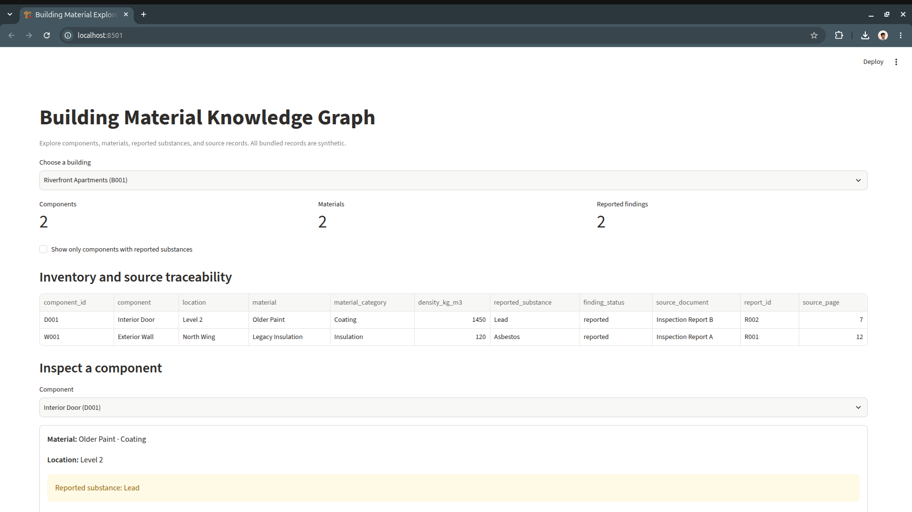
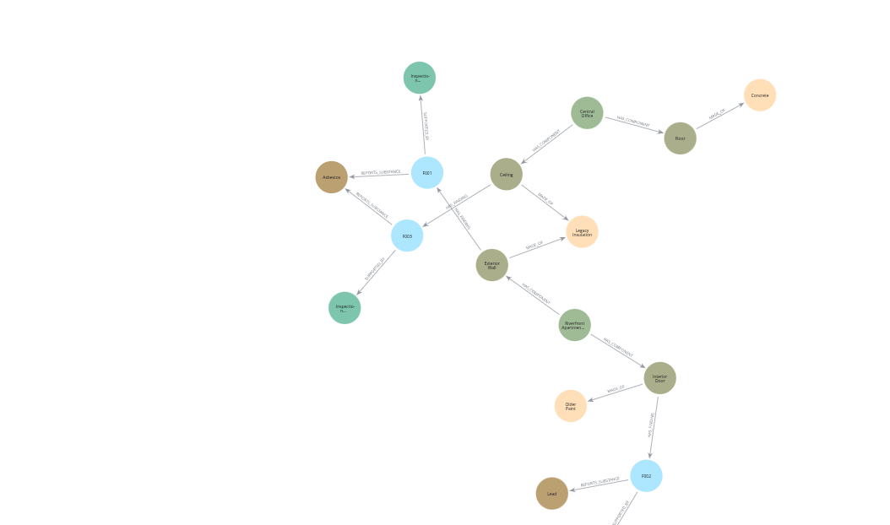

# Building Material Knowledge Graph

A local, interactive knowledge graph for exploring building inventories, material properties, reported hazardous substances, and supporting source-record metadata.

**Tech stack:** Python · Neo4j · Cypher · RDFLib (RDF) · pySHACL (SHACL) · Streamlit · Docker

> **Demo project:** All included building and inspection data is synthetic. The sample inspection-report titles and page numbers are placeholders; original report PDFs are not included. A reported substance is not a confirmed laboratory finding, and an absent finding does not establish safety.

## Screenshots

### Interactive Streamlit dashboard

Select a building, review components and materials, filter reported substances, and inspect source-record metadata.



### Neo4j knowledge graph

Explore connected buildings, components, materials, findings, substances, and source documents.



## What problem does this solve?

Building inventory and inspection data is often spread across separate tables and reports. This project links related records so a user can answer questions such as:

- Which components belong to a building?
- What materials are associated with those components?
- Which components have reported hazardous-substance findings?
- Which report title and page number support each finding?

## Features

- **Graph data model:** Building, Component, Material, Finding, Substance, and SourceDocument nodes connected with explicit relationships.
- **Python ingestion:** Reads four CSV datasets, checks unique IDs and references, and loads records into Neo4j.
- **RDF semantic representation:** Generates a Turtle (`.ttl`) graph of the same core concepts.
- **SHACL validation:** Checks RDF data against constraints before Neo4j ingestion.
- **Cypher queries:** Traverses building, component, material, finding, and document relationships.
- **Streamlit UI:** Provides building selection, counts, inventory tables, reported-substance filtering, and component inspection.
- **Source traceability:** Preserves report identifiers, titles, and page numbers associated with findings.

## Architecture

```text
CSV files (data/)
      |
      v
Python ingestion (src/pipeline.py)
      |-- Check IDs and references
      |-- Build RDF graph --> data/building_graph.ttl
      |-- Validate RDF with SHACL (shapes/buildings.ttl)
      |
      v
Neo4j property graph <---- Cypher queries
      |
      v
Streamlit dashboard (app.py)
```

RDF and Neo4j are used for related but distinct purposes: RDF stores subject–predicate–object statements, while Neo4j stores a property graph queried with Cypher. The pipeline creates both representations; it does not use Neo4j as a native RDF triple store.

### Graph model

```text
(Building)-[:HAS_COMPONENT]->(Component)-[:MADE_OF]->(Material)
                               |
                               +--[:HAS_FINDING]->(Finding)
                                                       |--[:REPORTS_SUBSTANCE]->(Substance)
                                                       +--[:SUPPORTED_BY]->(SourceDocument)
```

A `Finding` node ties the reported substance to a specific component and source record, avoiding an unsupported claim that every use of a material contains the same substance.

## Sample data

The `data/` directory contains four synthetic CSV files:

| File | Contents |
| --- | --- |
| `buildings.csv` | Building IDs, names, and cities |
| `components.csv` | Component IDs, building references, locations, and material references |
| `materials.csv` | Material IDs, names, categories, and densities |
| `findings.csv` | Reported substances, component references, report details, and source pages |

The provided dataset produces **2 buildings, 4 components, 3 materials, 3 findings, 2 substances, and 3 source documents** (17 nodes total), with 17 relationships when initially loaded into an empty database.

## Run locally

### Prerequisites

- Python 3.10 or newer
- Docker Engine or Docker Desktop, with Docker Compose

### 1. Start Neo4j

From the project root:

```bash
docker compose up -d
```

On Linux, if your account does not have permission to access the Docker socket, use `sudo docker compose up -d` instead.

The Neo4j Browser is at <http://localhost:7474>. The example configuration uses:

- **Username:** `neo4j`
- **Password:** `localpassword123`

These are **local demo credentials only**. Change the password and configuration before any non-local deployment.

### 2. Create and activate a Python environment

On Linux/macOS:

```bash
python3 -m venv .venv
source .venv/bin/activate
```

On Windows PowerShell:

```powershell
python -m venv .venv
.venv\Scripts\Activate.ps1
```

### 3. Install dependencies

```bash
python -m pip install -r requirements.txt
```

### 4. Configure local environment variables

On Linux/macOS:

```bash
cp .env.example .env
```

On Windows PowerShell:

```powershell
Copy-Item .env.example .env
```

The `.env` file contains the Neo4j URI, username, password, and database name. **Do not commit `.env` to GitHub.**

### 5. Generate RDF and validate it with SHACL

```bash
python -m src.pipeline --validate-only
```

This creates `data/building_graph.ttl` and should report:

```text
Validation Report
Conforms: True
```

### 6. Load data into Neo4j

```bash
python -m src.pipeline
```

This repeats validation and then ingests nodes and relationships into Neo4j. The terminal should end with `Neo4j ingestion completed`.

### 7. Launch the dashboard

```bash
streamlit run app.py
```

Open <http://localhost:8501>.

## Example Cypher queries

**Display the connected graph:**

```cypher
MATCH (n)-[r]->(m)
RETURN n, r, m
LIMIT 100
```

**Show buildings, components, and their materials:**

```cypher
MATCH (b:Building)-[:HAS_COMPONENT]->(c:Component)-[:MADE_OF]->(m:Material)
RETURN b.name AS building, c.name AS component, m.name AS material
ORDER BY building, component
```

**Trace reported substances to source metadata:**

```cypher
MATCH (b:Building)-[:HAS_COMPONENT]->(c:Component)-[:HAS_FINDING]->(f:Finding)-[:REPORTS_SUBSTANCE]->(s:Substance)
MATCH (f)-[:SUPPORTED_BY]->(d:SourceDocument)
RETURN b.name AS building,
       c.name AS component,
       s.name AS reported_substance,
       d.title AS source_document,
       f.source_page AS source_page
ORDER BY building, component
```

Additional queries are in [`queries/examples.cypher`](queries/examples.cypher).

## Tests

Run:

```bash
pytest -q
```

The included tests check that sample RDF data passes validation, that a component missing a required material relationship fails validation, and that building resources are created. They do not yet constitute a full integration test suite for Neo4j or Streamlit.

## Project structure

```text
building-material-kg/
├── app.py
├── docker-compose.yml
├── requirements.txt
├── .env.example
├── README.md
├── data/
│   ├── buildings.csv
│   ├── components.csv
│   ├── materials.csv
│   └── findings.csv
├── src/
│   └── pipeline.py
├── shapes/
│   └── buildings.ttl
├── queries/
│   └── examples.cypher
├── tests/
│   └── test_pipeline.py
└── screenshots/
    ├── dashboard.png
    └── knowledge-graph.png
```

`data/building_graph.ttl` is generated by the pipeline and can be regenerated; `.env` and `.venv/` are local files and should not be committed.

## Limitations and possible improvements

- This is a **local portfolio MVP**, not a production hazardous-material assessment system.
- Source report titles/pages are metadata placeholders; the UI does not open original PDFs.
- Findings reflect **reported** substances, not independently verified lab results.
- `MERGE` makes repeated imports use stable IDs, but the pipeline does **not** reconcile removed records or delete obsolete relationships.
- Potential future work includes linking real source documents, richer SHACL shapes, more comprehensive tests, authentication, data versioning, and larger-dataset ingestion.

## Stop the database

```bash
docker compose down
```

This stops the container while retaining its named Docker data volume. Do not use `docker compose down -v` unless you intend to delete the database volume.
